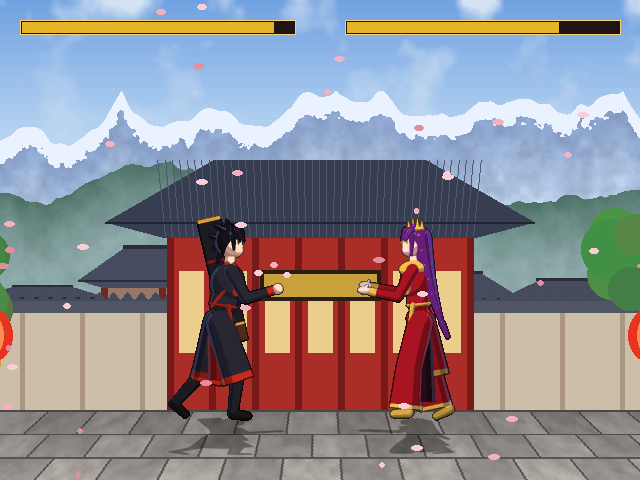
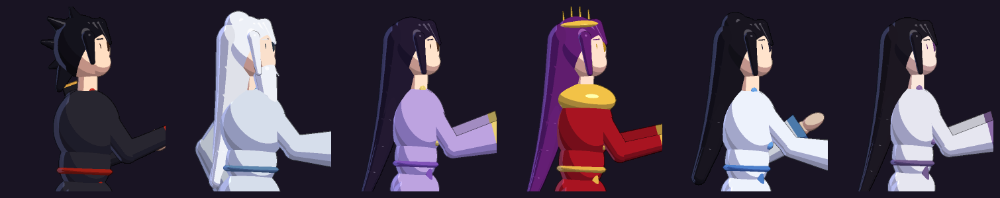
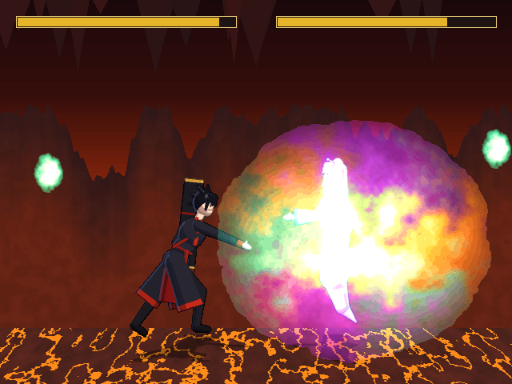
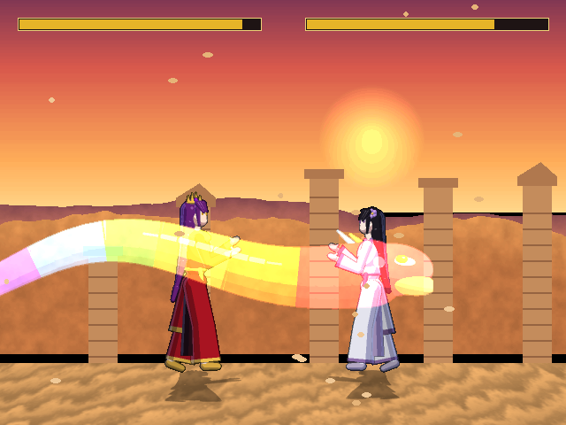

# Battle Through the Heavens 2.5D

A fan-made, non-commercial 2.5D fighting game based on *Battle Through the Heavens (Doupo Cangqiong)*,
built as content for the MUGEN engine family. It targets **Ikemen GO**, the free, open-source engine that
runs MUGEN characters and stages.



The six fighters, their moves and their Heavenly Flames come from the *Characters & Techniques* reference doc.
All sprites are original. They are 3D-modelled, cel-shaded and pre-rendered (that's the "2.5D" part),
like the 3D-CG donghua. The stages use layered parallax and a perspective floor.



| | |
|---|---|
|  |  |

## Quick start

1. Get the engine and install the content:
   * **Windows:** right-click `install.ps1` and choose *Run with PowerShell*.
   * **Linux / macOS:** run `./install.sh` in a terminal.

   The script downloads the latest Ikemen GO release into `./ikemen`. It then copies `game/chars`,
   `game/stages` and `game/data/select.def` into that folder. Your original `select.def` is kept
   as `select.def.orig`. If you already have Ikemen GO (or MUGEN 1.1), just copy those three paths
   into your install yourself.
2. Start `Ikemen_GO`. You can play Arcade, Versus, Training, Watch, and so on.

## Controls

Ikemen GO's default player-1 keyboard layout is shown below. You can change keys or set up a gamepad in
**Options → Key Config**. "Forward" and "Back" are relative to the way your fighter is facing.

| Key | Action |
|---|---|
| Arrow keys | move / jump / crouch. Hold Back to block |
| **A** / **S** | light / heavy punch |
| **Z** / **X** | light / heavy kick |
| **D** | **special button** |
| **C** | **super button** (needs power) |
| Enter | taunt (builds power) |
| Forward or Back + **S**, up close | throw |
| Forward, Forward / Back, Back | run / hop back |
| **A + S** in the air | air recovery |

### Easy specials and supers

| Input | Xiao Yan | Yao Lao | Xun'er | Medusa | Yun Yun | Little Fairy Doctor |
|---|---|---|---|---|---|---|
| **D** | Octane Blast | Bone Chilling Flame | Emperor Seal: Open Mountain | Venomous Flame | Wind Blade | Poison Mist |
| **Forward + D** | Flame Splitting Tsunami | Soul Shock (unblockable) | - | Serpent Lunge | - | Toxic Palm |
| **Down + D** | Rising Flame Ruler | Healing Pill (half a bar) | Golden Flame Rise | Spatial Seal | Rising Gale | Poison Field |
| **Back + D** | - | Spirit Drift (teleport) | Ocean Reversal | - | Wind Step (teleport) | - |
| **C** (1 bar) | Skyfire Three Mysterious Change | Bone Chilling Flame Torrent | Emperor Seal Skill (five seals) | Seven-Coloured Python | Sword Storm | Woeful Poison Body |
| **Down + C** | Buddha's Angry Lotus (**3 bars**) | Soul Realm Domination (2 bars) | Golden Emperor Burning Heaven Flame (2 bars) | Spatial Collapse (2 bars) | Thousand Wind Swords (2 bars) | Poison Calamity (2 bars) |

The classic fighting-game motions still work too, for example quarter-circle forward + punch. Every
`movelist.txt` lists both inputs.

Each character folder also has a `movelist.txt`. The CPU opponent has its own logic (anti-airs, zoning, combos)
whenever the engine's AI is active.

Stages: **Xiao Clan Courtyard**, **Tagore Desert Ruins**, **Yun Lan Sect Peak** and **Heavenly Flame Cavern**.

## About the sounds and pictures

This repository contains no audio or images taken from the show. Ripping the donghua's audio and putting it
in a repository would mean redistributing copyrighted recordings, even for a personal project. So:

* Every sound effect and voice grunt is **synthesised** by `tools/sfx.py`: flames, ice, wind, gongs, poison
  bubbles, impacts and formant-synth kiai shouts.
* **You can use your own clips.** Save PCM `.wav` files as `sounds/custom/<character>/<group>_<index>.wav`,
  then run `python3 tools/build.py <character>`. `sounds/SLOTS.md` lists what every slot is used for, for
  example `xiaoyan/0_3.wav` is the super-move cry. These custom files are only used on your machine when
  you rebuild.
* Character looks follow the reference doc and the donghua designs. Examples: Xiao Yan's black robes and Heavy
  Profound Ruler, Medusa's crimson and gold gown with crown, Yun Yun's white robes and sword, Yao Lao's
  translucent spirit form. Every sprite is generated from 3D primitives by `tools/render3d.py`.
* No stage music is included. Add your own by putting a track in the Ikemen `sound/` folder and setting
  `bgmusic =` in a stage's `.def` file.

## Rebuilding / modding

Everything in `game/` is generated. Requirements: Python 3.10+ with `numpy` and `Pillow`.

```bash
python3 tools/build.py              # everything (about 3 min on 4 cores)
python3 tools/build.py medusa       # one character
python3 tools/build.py --stages     # stages too
python3 tools/lint.py               # validate all generated files
python3 tools/preview.py scene xiaoclan xiaoyan medusa 0 0 shot.png   # mock screenshot
python3 tools/preview.py gif xuner 3000 seal.gif                       # animation preview
```

| File | What it does |
|---|---|
| `tools/render3d.py` | z-buffered capsule/ellipsoid/slab renderer with toon shading and outlines |
| `tools/rig.py`, `tools/designs.py` | skeleton, costumes, hair, weapons and colours for each fighter |
| `tools/anims.py`, `tools/specials.py` | keyframed poses for every action and special move |
| `tools/fx.py` | flames, lotus, seals, python, wind, poison mist and other effects |
| `tools/cnsgen.py` | states, hit definitions, commands and CPU AI (`.cns` / `.cmd`) |
| `tools/stages.py` | painted parallax stages |
| `tools/sffv2.py`, `tools/snd.py` | writers for the SFF v2 sprite and SND sound archives |
| `tools/lint.py` | checks sprites, animations, sounds, states and commands against Ikemen GO's own list of controllers, parameters and triggers |

Hitboxes are worked out automatically from the 3D skeleton of every frame.

## Status

The sprite and sound file formats were written to match Ikemen GO's loader source, and `tools/lint.py`
checks every reference. The game hasn't been play-tested inside the engine yet, so balance and timing will
need tuning. Please open an issue with anything that looks or feels off.

*Battle Through the Heavens* belongs to Tian Can Tu Dou and its licensors. This is a free fan project, not for sale.
